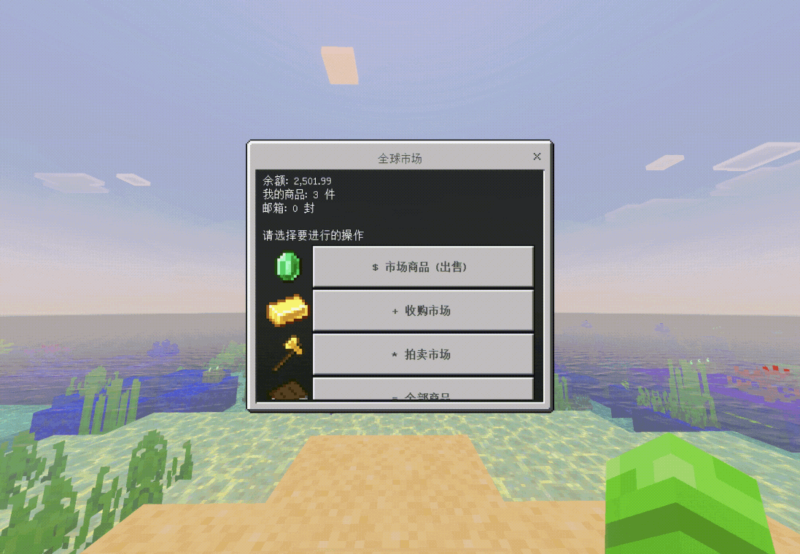

<p align="center">
  
</p>

<h1 align="center">GlobalMarketPlusBedrock</h1>
<p align="center">为 GlobalMarketPlus 提供基岩版市场表单</p>
<p align="center">
  <a href="#前置版本与服务端"></a>
  <a href="#前置版本与服务端"></a>
  <a href="#前置版本与服务端"></a>
  <a href="#前置版本与服务端"></a>
  <a href="#前置版本与服务端"></a>
  <a href="#前置版本与服务端"></a>
</p>

<p align="center"><a href="readme.md">English</a> · <b>简体中文</b></p>
<p align="center">
  <a href="https://github.com/che11111/GlobalMarketPlusBedrock/releases">下载插件</a> ·
  <a href="https://github.com/che11111/GlobalMarketPlusBedrock/issues">反馈问题</a> ·
  <a href="https://bstats.org/plugin/bukkit/GlobalMarketPlusBedrock/34829">bStats</a>
</p>

GlobalMarketPlusBedrock 是 [GlobalMarketPlus](https://www.spigotmc.org/resources/103648/) 的附属插件。它为通过 Geyser 和 Floodgate 进入服务器的基岩版玩家提供原生市场、拍卖、商店、档案和邮箱表单。权限、库存、扣款、税费及物品发放仍由 GMP 处理。本文同时作为安装、配置和管理手册。

## 功能演示

<p align="center">
  
</p>

## 功能

- 为出售、收购、拍卖、商品管理、邮箱、商店、商家档案及分类提供基岩版表单。
- 支持商品搜索、筛选、分页、排序和图片；可只读预览潜影盒与收纳袋内容，不开放物品取放。
- 支持创建和管理商品、修改价格与选项、参与竞拍/提前成交，以及邮箱操作；校验和交易仍交由 GMP 处理。


## 前置、版本与服务端

| 项目 | 要求及兼容情况 |
| --- | --- |
| 服务端软件 | **1.16+** Spigot、Paper；Purpur；Folia 等 |
| GlobalMarketPlus | 「**必需**」；基于 **1.4.3.0** 开发，其他版本需要另行验证 |
| Floodgate | 「**必需**」,安装在**运行本附属的后端服**，代理端安装不能替代后端 API |
| Geyser | 基岩玩家连接所需，可部署在代理端或后端 |
| PlaceholderAPI | 「**必需**」，用于解析附属文案中的占位符 |

插件可用版本范围取决于 GMP、Geyser、Floodgate 和 PlaceholderAPI 的兼容性。

## 安装与升级

1. 在后端安装 GlobalMarketPlus、Floodgate 和 PlaceholderAPI，并配置好 Geyser 连接。
2. 下载插件，放入 `plugins/`。
3. 启动插件，并使用基岩版进入服务器，执行 `/gmpbe`、`/bemarket` 或完整指令 `/globalmarketplusbedrock`。

升级时保留已有配置和语言文件。重载会补齐缺失默认项并保留已有值；无效 YAML 会保留原文件并回退到上一次可用或内置文案。修改配置或语言文件后执行 `/gmpbe reload`。

## 命令与权限

| 命令 | 权限 | 默认 |
| --- | --- | --- |
| `/globalmarketplusbedrock` | `globalmarketplusbedrock.use` | 所有人 |
| `/gmpbe reload` | `globalmarketplusbedrock.admin` | OP |
| `/gmpbe update` | `globalmarketplusbedrock.admin` | OP |

别名：`/gmpbe`、`/bemarket`。完整指令：`/globalmarketplusbedrock`。

本附属的权限不会授予 GMP 权限。读取菜单遵循 GMP 可配置的权限节点、默认权限、允许的用户组，以及货币权限、模块开关和禁用世界。所有写操作仍经过 GMP 命令校验。

## 菜单功能对照

| GMP 内置菜单族 | 基岩版表单实现 |
| --- | --- |
| GlobalMarketGUI | 出售、收购、拍卖列表，分页、分类、GMP 排序和手动刷新 |
| TransactionGUI | 整售/零售、整数数量输入、报价合计及二次确认 |
| AuctionGUI | 查看当前拍价、最高出价人，手动输入及 ±10/100/1000 加减价；商品管理中提前成交 |
| MerchandiseGUI | 我的商品、下架、整售/零售价格，永不过期、无限商品、隐藏商品/卖家名开关；按 UID 授权管理他人商品 |
| MailboxGUI | 待领取/全部/过期/已领取筛选，逐封领取/删除，整个邮箱批量领取/删除，分类与排序 |
| MerchantProfileGUI | 商店名/简介编辑，隐藏开关、商店打烊、邮箱锁定、排序/分类及商家缓存刷新 |
| MerchantStoreGUI | 商店摘要、简介、统计及商品分页浏览和交易 |
| MerchantStoreListGUI | 商店列表、分页及进入商店；访客列表不展示打烊商店 |
| CategoryGUI | 选择/重置 GMP 分类，应用到市场、商店及邮箱列表 |
| SearchGUI | 材质、卖家、物品名/描述、价格区间、货币、分类及类型筛选；查找相似商品 |
| SellInventoryGUI | 表单输入价格后，进入 **GMP 原生箱式界面**完成等价/均价批量出售 |
| BuyInventoryGUI | 表单输入价格后，进入 **GMP 原生箱式界面**完成等价/均价批量收购 |

前 10 类已提供表单流程，后 2 类保留 GMP 的原生批量界面。目前没有找到 GMP 完整的批量上架校验、税费、扣物品及失败返还 API，因此当前没有实现纯表单的多槽位批量上架。

### 交易、竞拍与上架

- 点击商品，选择整单或零售，再确认数量与报价合计。价格、货币、交易模式或整单数量变化时，会要求重新确认；最终税费及结算按 GMP 配置执行。
- 交易结果事件到来后，如果玩家仍停留在该笔交易的等待表单，会返回原列表。其他操作通过聊天栏结果及刷新/返回按钮确认；命令成功派发不会被当作交易成功。
- 上架时选择出售、收购或拍卖，在倒计时中手持目标物品，再输入价格和数量。出售/收购明确选择整售或零售；提交前再次检查手持物品和快捷栏位置。
- **整售价是整单商品的总价，零售价是每件单价。** 高级设置中输入 `-1` 可关闭对应交易方式。`0` 是实际数值，是否允许由 GMP 价格限制决定；取消操作请关闭表单或点击取消。
- 拍卖提前成交遵循 GMP 当前最高出价及成交规则。

### 搜索、商店与档案

搜索按文字内容匹配，忽略大小写，不执行正则表达式；货币标识忽略大小写后精确匹配。价格筛选优先使用整售报价，未开放整售时使用零售报价。玩家当前分类也会参与筛选，找不到商品时可尝试重置分类。

从“全部商店”进入商店摘要，再浏览店内商品。个人档案支持重命名商店，以及跨页追加、修改、删除简介行。简介在编辑期间变化时，会要求刷新，避免错改其他行。

分类名、排序说明、本地化物品名及 GMP 聊天反馈来自 GMP，使用 **GMP 自己的语言和配置**，不会被本附属的英文/中文切换自动翻译。

### 邮箱与潜影盒预览

“全部领取”和“全部删除”作用于**整个目标邮箱**，包括被当前分类或状态筛选隐藏的邮件。删除需要二次确认，也会删除未领取物品，无法撤销。领取权限和背包容量由 GMP 校验。

市场商品、自己管理的商品和邮件中的潜影盒、收纳袋支持**只读内容预览**。可查看原槽位、数量、名称、描述和附魔，并按配置查看内层容器。预览克隆物品，不提供可移动物品的库存界面。自定义物品必须实际携带 Bukkit 支持的容器元数据才能读取内容。

## 配置文件

配置文件位于 `plugins/GlobalMarketPlusBedrock/config.yml`。首次启动自动生成。改动后执行 `/gmpbe reload`；语言文案另见 `plugins/GlobalMarketPlusBedrock/lang/zh_CN.yml` 和 `lang/en_US.yml`。

```yaml
# 界面语言：zh_CN 或 en_US
language: zh_CN

# 启动 5 秒后及每 6 小时检查 GitHub 最新正式版，只提示，不自动替换 JAR。
check-for-updates: true

# 本插件 bStats 开关；同时遵循 plugins/bStats/config.yml 的全局开关。
bstats:
  enabled: true

# 玩家加入后是否自动打开市场表单。
auto-open-on-join: false
# 自动打开延迟秒数（1–3600）。
auto-open-delay: 1

# 表单列表每页最多条目数（1–100）。
page-size: 20
# 商品展示缓存毫秒数（0–5000）；0 表示不复用展示快照，交易仍重新读取 GMP 数据。
display-cache-millis: 1000
# 将支持的玩家 GMP 菜单命令转为基岩表单；写操作仍交由 GMP。
bridge-gmp-commands: true
# 潜影盒/收纳袋内容预览的最大嵌套层数（1–8）。
container-preview-depth: 4

# 商品、邮箱和容器内容按钮的物品图片。
item-icons:
  enabled: true
  auto:
    enabled: true
    # 内置纹理路径来自 Minecraft Java 26.3；只改版本号不会重新生成路径映射。
    version: '26.3'
    # 旧版内置默认地址会升级到当前版本；关闭后仍可保留旧版本。
    upgrade-legacy-default: true
    # {path} 是映射里的 item/... 或 block/... 路径；基岩客户端直接下载 PNG。
    url-format: 'https://raw.githubusercontent.com/InventivetalentDev/minecraft-assets/{version}/assets/minecraft/textures/{path}.png'
  # 自动映射和手动映射均没有命中时使用；留空表示只显示文字。
  fallback: ''
  # 按 Bukkit Material 名称覆盖原版图片。
  materials: {}
  # 按 Material + 整数 CustomModelData 覆盖图片。
  custom-model-data: {}

# 功能/导航按钮和商品按钮的显示风格。
button-style:
  images: true
  symbols: true
  function-bold: true
  function-color: '&8'
  product-color: '&6'
  # 可按角色覆盖功能按钮图标/文字符号，例如 search、back。
  functions: {}

# 点击创建商品后，手持目标物品的倒计时秒数（0–300）。
countdown:
  seconds: 10
```

### 商品图片配置

`item-icons` 只影响商品/邮件/容器物品按钮的图片，不会改动物品本身，也不会创建或安装资源包。优先级是 **CustomModelData → Material 覆盖 → 内置原版映射 → fallback → 纯文字**。Material 映射适用于该材质的所有商品；`custom-model-data` 可为同一基础材质下的不同整数自定义模型设置不同缩略图。把值设为 `none` 可主动关闭对应图标。

- `path;;textures/items/...` 或 `path;;textures/blocks/...`：从基岩客户端当前加载的资源包读取路径。
- `url;;https://...png`：由基岩客户端直接访问的公开图片地址；服务器能访问不代表每个玩家客户端也能访问。
- `materials`：Material 名称到图片的映射，例如 `DIAMOND`。
- `custom-model-data`：Material 名称下按整数 CMD 继续分表，例如 `PAPER` 的 `1001`。

```yaml
item-icons:
  materials:
    OMINOUS_BOTTLE: 'url;;https://example.com/icons/ominous_bottle.png'
    DIAMOND: 'path;;textures/items/diamond'
  custom-model-data:
    PAPER:
      '1001': 'url;;https://example.com/icons/merchant-token.png'
  fallback: 'path;;textures/items/book_normal'
```

表单图片是二维图片，不能直接显示 Java 自定义三维模型。自定义模型应另备 PNG 缩略图或基岩资源包纹理，再通过 Material/CMD 映射。图标 URL 不可访问时客户端可能显示空白；插件无法从服务端获知客户端是否成功加载图片。

### 更新 Minecraft 图标映射

`tools/generate_item_textures.py` 是**开发/打包时使用的生成工具**，不是服务器插件功能。它读取你指定的原版 Java `client.jar`，解析 `assets/minecraft/items/` 与模型父级中的纹理引用，并只把 `Material → item/... 或 block/...` 路径写入 `src/main/resources/item-textures.yml`；不会复制 PNG 图片、不会改动运行服，也不会自动联网更新。脚本兼容旧版模型、新版物品定义和 26.x 的 sprite 对象。

当前仓库映射由 Minecraft Java 26.3 生成。获取另一个正式版本的客户端 JAR 后，在项目根目录运行：

```bash
python3 tools/generate_item_textures.py /path/to/client.jar 26.3
```

把 `26.3` 换成客户端版本号；重新打包插件后，才会把新映射带入 JAR。`item-icons.auto.version` 控制默认图片 URL 使用的纹理仓库版本，**只改它不会更新映射**。当前随插件内置的 26.3 映射包含 1660 个材质名/纹理路径（含旧服务端名称别名），用于支持的旧服务端中已有材质，也覆盖 26.3 新增物品名称；这不代表插件已兼容 Minecraft 26.3 服务端，目前服务端 API 验证范围仍见上文。

功能按钮图片用基岩原版资源路径，由 `button-style` 配置；与这里的商品图片映射相互独立。

## 常见问题

| 现象 | 检查方向 |
| --- | --- |
| 提示仅限基岩版或没有表单 | 后端 Floodgate 是否识别玩家；代理密钥/配置及附属权限是否正确 |
| 列表为空 | 当前分类、搜索条件、隐藏标志、货币权限、商店是否打烊 |
| 提交后没有完成操作 | 查看 GMP 聊天反馈中的权限、余额、税费、库存、冷却限制，再刷新 |
